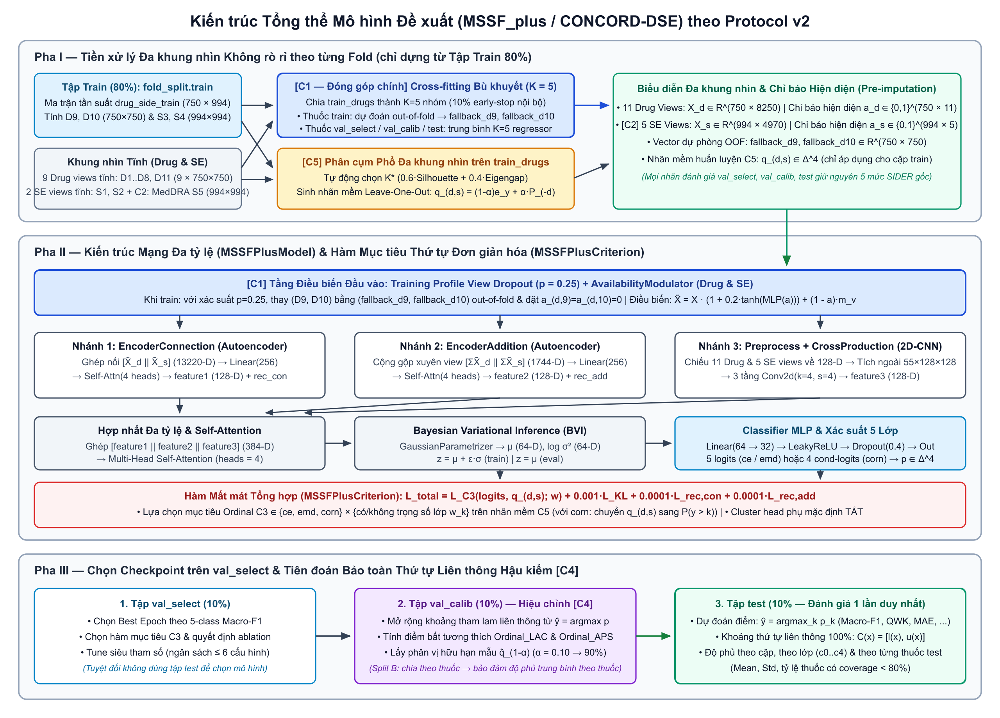

# Báo cáo Kiến trúc Mô hình Đề xuất & Cấu trúc Mã nguồn (`MSSF_plus/`)

> **Mục đích tài liệu**: Tài liệu kỹ thuật đầy đủ mô tả kiến trúc toán học, kích thước tensor, luồng dữ liệu không rò rỉ (Protocol v2) và bản đồ mã nguồn của mô hình đề xuất cùng hệ thống đánh giá chuẩn hóa trong `MSSF_plus/`. Tài liệu được thiết kế để dùng trực tiếp làm khung tham chiếu khi viết phần **Methodology**, vẽ **Architecture Figure**, và trình bày **Experimental Setup & Ablation Study** cho bài báo.

---

## 1. Tổng quan Bài toán & 5 Đóng góp Cốt lõi của Mô hình Đề xuất

### 1.1. Định nghĩa bài toán
Cho tập $N_d = 750$ thuốc và $N_s = 994$ tác dụng phụ (Side Effects — SE). Trên các cặp tương tác đã được ghi nhận trong SIDER ($37{,}071$ cặp dương), mỗi cặp $(d, s)$ mang một nhãn tần suất thứ tự 5 mức:
$$y^{\text{freq}}_{d,s} \in \{1, 2, 3, 4, 5\} \;\Longleftrightarrow\; y_{d,s} = y^{\text{freq}}_{d,s} - 1 \in \{0, 1, 2, 3, 4\}$$
tương ứng với: *Very Rare* ($c_0$, $3.06\%$), *Rare* ($c_1$, $11.49\%$), *Infrequent* ($c_2$, $26.85\%$), *Frequent* ($c_3$, $47.41\%$), và *Very Frequent* ($c_4$, $11.19\%$).

Mô hình được đánh giá đồng thời trên hai kịch bản thực tế:
- **Split A (Warm-Start / Pair-level 10-fold CV)**: Dự đoán mức độ thường gặp của tác dụng phụ mới trên các thuốc đã biết một phần hồ sơ tương tác.
- **Split B (Cold-Start Drug / Drug-level 10-fold CV)**: Dự đoán tần suất tác dụng phụ cho **thuốc hoàn toàn mới** chưa từng có bất kỳ cặp tương tác nào trong tập huấn luyện ($75$ thuốc test / fold, toàn bộ hàng tương tác bằng $0$).

> **Ghi chú đặt tên trong bài báo**: Trong mã nguồn, thư mục gói giữ tên kỹ thuật `MSSF_plus/` để đảm bảo tính kế thừa và tương thích đường dẫn; khi viết bài báo, có thể trình bày mô hình dưới tên độc lập như **CONCORD-DSE** (*Cold-start Multi-view Ordinal Network with Conformal Prediction for Drug Side-Effect Frequency*) hoặc **MOSAIC-DSE**.

### 1.2. Bảng ánh xạ các thành phần kỹ thuật (`C1`–`C5`) với mã nguồn (Cấu hình Mô hình Cuối = `cand_A`)

| Ký hiệu | Vai trò & Tên thành phần | Vấn đề khoa học giải quyết | Module hiện thực chính | Cấu hình Mô hình Cuối (`cand_A`) |
| :---: | :--- | :--- | :--- | :--- |
| **C1** *(Rút gọn ở mô hình cuối)* | **Mô phỏng Cold-Start khi Huấn luyện (Training-Time Profile View Dropout)** | Ở thuốc mới (Split B), hai view hồ sơ tương tác `D9, D10` bằng `0`; việc ngẫu nhiên đặt `D9, D10 = 0` với xác suất $p_{\text{cold}}$ ngay khi train buộc mạng học cách dự đoán từ 9 view tĩnh mà không cần bộ bù khuyết hay modulator. | `MSSF_plus/views.py`, `MSSF_plus/model.py` | `c1_view_dropout_prob` $\in \{0.15, 0.25\}$ (chọn trên `val_select`), `c1_impute='zero'`, `c1_use_availability=False`, `use_bvi=False` |
| **C2** | **Hierarchical MedDRA Ontology Side-Effect View (`S5`)** | 4 view SE gốc phụ thuộc mạnh vào hồ sơ tương tác (`S3, S4`) và thiếu cấu trúc phân cấp y khoa chuẩn MedDRA cho toàn bộ 994 SE. | `MSSF_plus/views.py` | `c2_se_mode='plus_ontology'` ($V_s = 5$ views, `4970-D`) |
| **C3** *(Lựa chọn hàm mục tiêu)* | **Lựa chọn Hàm Mục tiêu Thứ tự (Ordinal Objective Selection) & Cân bằng Lớp** | Đánh giá hệ thống 3 họ hàm mục tiêu (`ce`, `emd`, `corn`) kết hợp trọng số nghịch tần suất lớp (`unweighted` / `weighted`) trên nhãn mềm thứ tự, chọn cấu hình tối ưu trên `val_select`. | `MSSF_plus/losses.py` | `c3_loss_type='ce'`, `c3_class_weighting=False` (chốt từ Giai đoạn 4 trên `val_select`) |
| **C4** | **Post-hoc Contiguous Ordinal Conformal Prediction (kèm Độ phủ theo Thuốc ở Split B)** | Dự đoán điểm đơn lẻ không định lượng được độ bất định lâm sàng; các phương pháp Conformal chuẩn (`LAC`, `APS`) sinh ra tập lớp bị đứt quãng. | `MSSF_plus/conformal.py` | `Ordinal_LAC` & `Ordinal_APS` ($\alpha = 0.10$, độ phủ mục tiêu $90\%$) |
| **C5** | **Multi-View Spectral Clustering Leave-One-Out Soft Labels** | Nhãn tần suất SIDER có nhiễu ranh giới giữa các lớp kế cận trên những thuốc có cùng cấu trúc hóa-sinh học đa khung nhìn. | `MSSF_plus/soft_labels.py`, `MSSF_plus/model.py` | `c5_mode='multi_view'`, `c5_alpha=0.15`, `c5_aux_cluster_weight=0.0` |

> **Phân tích phụ (Supplementary Diagnostic Analysis cho Paper)**: Các biến thể bù khuyết (`regress_ridge`, `regress_knn`, `regress` MLP, `mean`), `AvailabilityModulator`, và nhánh suy luận biến phân **BVI** đã được chứng minh thực nghiệm trên `val_select` (Giai đoạn 4 & Chọn ứng viên `cand_A..cand_D`) là không cần thiết trong mô hình cuối `cand_A`. Tuy nhiên, các cấu hình chẩn đoán có BVI (`C1_avail_only`, `loo_no_C1` so với `C3_ce_unweighted_ridge_selfcorr`) được giữ lại làm **phân tích phụ** để báo cáo hành vi của độ bất định hậu nghiệm $\bar{\sigma}$ (nhóm thuốc thiếu `D9, D10` có $\bar{\sigma}$ cao hơn rõ rệt khi không bù khuyết và thu hẹp về ngang bằng khi có bù khuyết).

---

## 2. Sơ đồ Kiến trúc Tổng thể (End-to-End Architecture)

> Sơ đồ được kết xuất sẵn dưới dạng ảnh độ phân giải cao (`MSSF_plus/figures/architecture_diagram.png` và bản vector `MSSF_plus/figures/architecture_diagram.svg`) để hiển thị trực tiếp khi xuất PDF.



---

## 3. Chi tiết Toán học & Kích thước Tensor của Từng Mô-đun

### 3.1. Hệ thống 11 Drug Views và 5 Side-Effect Views (`MSSF_plus/views.py`)

Mỗi thuốc $d \in \{0, \dots, 749\}$ được biểu diễn bởi $V_d = 11$ ma trận tương đồng kích thước $750 \times 750$ (hoặc $V_d = 9$ khi chạy biến thể `c1_impute='drop'`), và mỗi tác dụng phụ $s \in \{0, \dots, 993\}$ được biểu diễn bởi $V_s = 5$ ma trận tương đồng kích thước $994 \times 994$ ở cấu hình đầy đủ `plus_ontology` (hoặc $V_s = 4$ ở `original`, $V_s = 3$ ở `no_profile`):

| Nhóm | Ký hiệu trong code | Kích thước | Nguồn dữ liệu trong `shared_data/` | Tính chất theo Fold |
| :--- | :--- | :---: | :--- | :--- |
| **Drug Views** | `D1_stitch_one` .. `D5_stitch_five` | $5 \times (750 \times 750)$ | `mssf_750/Text_similarity_{one..five}.pkl` (5 kênh STITCH) | Tĩnh |
| | `D6_mol2vec_cos` | $750 \times 750$ | Cosine trên `mssf_750/drug_mol.pkl` (Mol2vec `100-D`) | Tĩnh |
| | `D7_target_cos` | $750 \times 750$ | Cosine trên `mssf_750/drug_target.pkl` | Tĩnh (có hàng thưa = 0) |
| | `D8_fingerprint` | $750 \times 750$ | `mssf_750/fingerprint_similarity.pkl` (Morgan Jaccard) | Tĩnh |
| | `D9_profile_freq_cos` | $750 \times 750$ | Cosine các hàng của ma trận tần suất `drug_side_train` (`selfcorr=1`) | **Tính lại từ `train` (80%)** |
| | `D10_profile_bin_cos` | $750 \times 750$ | Cosine các hàng của ma trận nhị phân `(drug_side_train > 0)` (`selfcorr=1`) | **Tính lại từ `train` (80%)** |
| | `D11_pathway_enzyme` | $750 \times 750$ | `mssf_750/drug_pathway_enzyme_similarity.pkl` | Tĩnh (có hàng thưa = 0) |
| **SE Views** | `S1_adrecs_semantic` | $994 \times 994$ | `mssf_750/side_effect_semantic.pkl` (ADReCS DAG) | Tĩnh |
| | `S2_glove_cos` | $994 \times 994$ | Cosine trên `mssf_750/glove_wordEmbedding.pkl` (`300-D`) | Tĩnh |
| | `S3_profile_freq_cos` | $994 \times 994$ | Cosine các cột của `drug_side_train.T` (`selfcorr=1`) | **Tính lại từ `train` (80%)** |
| | `S4_profile_bin_cos` | $994 \times 994$ | Cosine các cột của `(drug_side_train > 0).T` (`selfcorr=1`) | **Tính lại từ `train` (80%)** |
| | `S5_meddra_ontology_cos` (**C2**) | $994 \times 994$ | Cosine trên `side_effect_label_750.mat['node_label']` (`994 × 243` MedDRA) | Tĩnh (đủ 100% cho 994 SE) |

- Khi nối phẳng theo chiều đặc trưng cho một cặp $(d, s)$ trong mô hình cuối `cand_A`:
  - Đặc trưng thuốc: $x_d \in \mathbb{R}^{11 \times 750} = \mathbb{R}^{8250}$.
  - Đặc trưng SE: $x_s \in \mathbb{R}^{5 \times 994} = \mathbb{R}^{4970}$.

---

### 3.2. Thành phần C1 — Rút gọn còn "Mô phỏng Cold-Start khi Huấn luyện" ở Mô hình Cuối (`cand_A`) & Phân tích Ablation Bù khuyết (`views.py` & `model.py`)

1. **Cơ chế C1 trong Mô hình Cuối `cand_A` (`c1_impute='zero'`, `c1_use_availability=False`, `c1_view_dropout_prob` $= p_{\text{cold}}$)**:
   - Ở Split B (Cold-Start Drug), mọi thuốc mới thuộc `val_select`, `val_calib`, và `test` đều không có cặp tương tác huấn luyện nên hai hàng tương đồng hồ sơ `D9[d], D10[d]` hoàn toàn bằng `0`, trong khi mọi thuốc thuộc `train` đều có `D9[d], D10[d]` khác `0`. Sự lệch phân phối này khiến mô hình gốc (`MSSF_v2_selfcorr`) phụ thuộc quá mức vào `D9, D10` khi train và sụt giảm hiệu năng trên thuốc mới.
   - Trong `cand_A`, khi `model.train()`, với xác suất $p_{\text{cold}}$ độc lập cho từng mẫu trong mini-batch, hai view `D9, D10` của thuốc train được **đặt trực tiếp về vector `0`** (`_apply_c1_input_processing` trong `MSSF_plus/model.py`), mô phỏng chính xác trạng thái thiếu hồ sơ của thuốc mới lúc suy luận mà **không cần mạng bù khuyết hay `AvailabilityModulator`**.

2. **Bằng chứng thực nghiệm từ Ablation Giai đoạn 4 & Chọn ứng viên `cand_A..cand_D` (`val_select`, Split B & A)**:
   - Trên Split B (`val_select`, Folds 0–2), `C1_vdrop_only` đạt Macro-F1 = **`0.4176 ± 0.0258`**, cao hơn hoặc ngang bằng toàn bộ các biến thể kết hợp bù khuyết (`regress_ridge`: `0.4022`, `ridge_no_modulator`: `0.4121`, `regress` MLP: `0.4045`, `knn`: `0.4043`, `mean`: `0.4055`, `zero+modulator`: `0.4092`, `drop`: `0.4120`), trong khi chỉ bật `AvailabilityModulator` mà không có View Dropout (`C1_avail_only`) chỉ đạt **`0.3413 ± 0.0149`**.
   - Khi kết hợp với `C2 + C5 + CE` và bỏ BVI (`cand_A..cand_D`), hiệu số trung bình theo cặp fold so với `cand_A` của `cand_B` (+modulator: `+0.0026 ± 0.0062` trên Split B, `+0.0049 ± 0.0085` trên Split A), `cand_C` (+ridge impute: `+0.0032 ± 0.0020` trên Split B, `+0.0005 ± 0.0015` trên Split A), và `cand_D` (+cả hai: `+0.0114 ± 0.0086` trên Split B, `+0.0034 ± 0.0134` trên Split A) đều **nhỏ hơn 1 độ lệch chuẩn giữa các fold** $\rightarrow$ theo quy tắc ưu tiên cấu hình đơn giản hơn, **`cand_A`** được chọn làm mô hình cuối.

---

### 3.3. Lõi Biểu diễn Đa tỷ lệ, Hợp nhất Self-Attention & Chiếu Tất định Không BVI ở `cand_A` (`MSSF_plus/model.py`)

Cặp biểu diễn $(x_d, x_s)$ đi qua **3 nhánh mã hóa bổ trợ nhau** (kế thừa cấu trúc đa tỷ lệ của MSSF gốc nhưng tổng quát hóa động cho $(V_d=11, V_s=5)$ và bỏ BVI ở `cand_A`):

1. **Nhánh 1 — `EncoderConnection` (Tương tác ghép nối toàn cục + Autoencoder — `7,112,484` tham số ở $V_d=11, V_s=5$)**:
   - Ghép toàn bộ các view: $u_{\text{con}} = [x_d \,\|\, x_s] \in \mathbb{R}^{B \times 13220}$ ($750 \times 11 + 994 \times 5 = 13220$).
   - Mã hóa: `Linear(13220 -> 256) -> BatchNorm1d -> LeakyReLU(0.01) -> Dropout(0.4) -> Attention(256, heads=4) -> Linear(256 -> 128)` tạo `feature1` $\in \mathbb{R}^{B \times 128}$.
   - Giải mã phụ trợ: `Linear(128 -> 256) -> BN -> LeakyReLU -> Dropout -> Linear(256 -> 13220)` tạo `rec_con` phục vụ loss tái tạo $\mathcal{L}_{\text{rec,con}}$.

2. **Nhánh 2 — `EncoderAddition` (Cộng gộp đồng thuận xuyên view + Autoencoder — `1,225,296` tham số)**:
   - Cộng từng phần tử qua các view: $\bar{x}_d = \sum_{v=1}^{11} x_d^{(v)} \in \mathbb{R}^{B \times 750}$, $\bar{x}_s = \sum_{u=1}^{5} x_s^{(u)} \in \mathbb{R}^{B \times 994}$, rồi ghép $u_{\text{add}} = [\bar{x}_d \,\|\, \bar{x}_s] \in \mathbb{R}^{B \times 1744}$.
   - Qua kiến trúc đối xứng với nhánh 1 (`1744 -> 256 -> Attention -> 128`) tạo `feature2` $\in \mathbb{R}^{B \times 128}$ và tái tạo `rec_add` $\in \mathbb{R}^{B \times 1744}$.

3. **Nhánh 3 — `Preprocess` (`1,698,304` tham số) + `CrossProduction` phân rã đại số (`61,216` tham số)**:
   - `Preprocess`: $V_d=11$ mạng chiếu riêng đưa từng view thuốc `750-D` $\to e_d^{(v)} \in \mathbb{R}^{B \times 128}$; $V_s=5$ mạng chiếu riêng đưa từng view SE `994-D` $\to e_s^{(u)} \in \mathbb{R}^{B \times 128}$.
   - `CrossProduction` (`use_factored_crossprod=True`): Tầng `cnn[0]` (`Conv2d(k=4, s=4)`, trọng số reshape thành $(32, V_d, V_s, 4, 4)$) được tính trực tiếp từ $D \in \mathbb{R}^{B \times V_d \times 32 \times 4}$ và $S \in \mathbb{R}^{B \times V_s \times 32 \times 4}$ qua 2 phép nhân ma trận mà không cần khởi tạo tensor 4 chiều $(B, 55, 128, 128)$.
   - Đưa qua 3 khối `Conv2d(kernel_size=4, stride=4) + BatchNorm2d(32) + ReLU`: kích thước không gian thu gọn $128 \to 32 \to 8 \to 2$ với $32$ kênh, trải phẳng thành `feature3` $\in \mathbb{R}^{B \times 128}$.

4. **Hợp nhất Self-Attention (`591,744` tham số), Chiếu Tất định (`use_bvi=False`, `24,640` tham số) & Classifier (`2,245` tham số)**:
   - Ghép $h = [\text{feature1} \,\|\, \text{feature2} \,\|\, \text{feature3}] \in \mathbb{R}^{B \times 384}$, đưa qua `Attention(384, heads=4)`.
   - **Bỏ BVI ở mô hình cuối `cand_A` (`use_bvi=False`)**: thay vì nhánh biến phân $(\mu, \log\sigma^2)$, đặc trưng hợp nhất đi qua tầng chiếu tuyến tính tất định `det_proj: Linear(384 -> 64)` (`24,640` tham số, giảm một nửa so với `49,280` tham số của `GaussianParametrizer`).
   - **Đầu ra chính (`Classifier`)**: `Linear(64 -> 32) -> LeakyReLU(0.01) -> Dropout(0.4) -> Linear(32 -> 5)`.
   - **Phân tích phụ BVI $\sigma$ (không thuộc mô hình cuối `cand_A`)**: Ở các cấu hình chẩn đoán giữ BVI (`C1_avail_only`, `loo_no_C1` vs `C3_ce_unweighted_ridge_selfcorr`), $\bar{\sigma}$ của nhóm thuốc thiếu `D9, D10` cao hơn rõ rệt khi không bù khuyết và thu hẹp về ngang bằng khi có bù khuyết `regress_ridge`, nhưng $\sigma$ không tương quan thuận với kích thước tập dự đoán Conformal (`|C|`) nên BVI được loại bỏ khỏi `cand_A`.

---

### 3.4. Thành phần C5 — Phân cụm Phổ Đa khung nhìn & Làm trơn Nhãn mềm Không rò rỉ (`MSSF_plus/soft_labels.py`)

Kỹ thuật **Multi-View Spectral Clustering** được dùng để làm trơn nhãn huấn luyện theo cấu trúc cụm thuốc mà **không vi phạm ràng buộc cold-start hay rò rỉ nhãn test**:

1. **Hợp nhất ma trận tương đồng chuẩn hóa chỉ trên `train_drugs`**:
   - Với mỗi drug view $v$, trích ma trận con trên tập thuốc train $W^{(v)} = S^{(v)}[\mathcal{D}_{\text{train}}, \mathcal{D}_{\text{train}}]$, đối xứng hóa, đặt đường chéo bằng $0$, cắt không âm và chuẩn hóa bậc đối xứng $\widehat{W}^{(v)} = D_v^{-1/2} W^{(v)} D_v^{-1/2}$.
   - Hợp nhất các view thành ma trận tương đồng đồng thuận $W_{\text{fused}} = \text{Norm}\!\left(\sum_{v} \omega_v \widehat{W}^{(v)}\right)$ và lập Laplacian chuẩn hóa $L_{\text{sym}} = I - D^{-1/2} W_{\text{fused}} D^{-1/2}$.
2. **Tự động chọn số cụm tối ưu $K^* \in [k_{\min}, k_{\max}]$**:
   - Giải bài toán trị riêng $L_{\text{sym}} u_j = \lambda_j u_j$, duyệt $K$ và chọn $K^*$ cực đại hóa chỉ số kết hợp giữa độ tách cụm Silhouette trên không gian phổ chuẩn hóa hàng $U_K$ và bước nhảy phổ (eigengap) $\Delta_K = \lambda_{K+1} - \lambda_K$:
     $$\text{Score}(K) = 0.6 \cdot \text{Silhouette}(U_K) + 0.4 \cdot \frac{\Delta_K}{\max_{K'} \Delta_{K'}}}$$
   - Thực nghiệm Giai đoạn 4 cho thấy tự động chọn $K^* \in [4, 12]$ (`C5_multi_view`: `0.3701 ± 0.0091`) và cố định $K=6$ (`C5_multi_view_fixedK6`: `0.3693 ± 0.0268`) có trung bình Macro-F1 ngang nhau trên Split B, nhưng tự chọn $K^*$ theo từng fold giảm phương sai giữa các fold xuống gần 3 lần (`± 0.0091` vs `± 0.0268`).
3. **Sinh phân phối nhãn mềm Leave-One-Out nghiêm ngặt ($d' \neq d$)**:
   - Với mỗi cặp huấn luyện $(d, s, y)$ thuộc cụm $c = c(d)$, xét tập các thuốc **khác $d$** trong cùng cụm $c$ cũng có tương tác huấn luyện đã biết với cùng SE $s$:
     $$\mathcal{N}_{c,s}^{(-d)} = \bigl\{(d', s, y_{d',s}) \in \mathcal{T}_{\text{train}} \;\big|\; c(d') = c,\; d' \neq d\bigr\}$$
   - Nếu $|\mathcal{N}_{c,s}^{(-d)}| \ge m_{\min}$, phân phối tần suất thực nghiệm $P_{c,s}^{(-d)} \in \Delta^4$ của cụm được trộn lồi với nhãn gốc:
     $$q_{d,s} = (1 - \alpha_{\text{c5}})\,\mathbf{e}_y + \alpha_{\text{c5}}\,P_{c,s}^{(-d)}, \qquad \alpha_{\text{c5}} = 0.15$$
   - Ngược lại, giữ nguyên nhãn cứng $q_{d,s} = \mathbf{e}_y$. Nhãn đánh giá trên `val_select`, `val_calib`, và `test` **tuyệt đối giữ nguyên nhãn SIDER gốc**.

---

### 3.5. Thành phần C3 — Hàm Mất mát của Mô hình Cuối `cand_A` (`MSSF_plus/losses.py`)

Ở mô hình cuối **`cand_A`** (`c3_loss_type='ce'`, `c3_class_weighting=False`, `use_bvi=False`), hàm mất mát huấn luyện hoàn toàn tất định (không còn số hạng $\mathcal{L}_{\text{KL}}$ do đã bỏ BVI):
$$\mathcal{L}_{\text{cand\_A}} = \mathcal{L}_{\text{CE}}(\text{logits}, q) + 10^{-4}\mathcal{L}_{\text{rec,con}} + 10^{-4}\mathcal{L}_{\text{rec,add}}$$
trong đó $\mathcal{L}_{\text{CE}}(\text{logits}, q) = -\sum_{k=0}^4 q_k \log p_k$ được tính trực tiếp trên phân phối nhãn mềm Leave-One-Out $q$ của C5.

Trong nghiên cứu Ablation Giai đoạn 4, 6 tổ hợp `{ce, emd, corn} × {unweighted, weighted}` đã được đối chiếu trên `val_select` của Folds 0–2 (cả Split B và Split A); `ce` không trọng số lớp (`unweighted`) đạt trung bình `Macro-F1` cao nhất (`0.4179 ± 0.0230` trên Split B và `0.6509 ± 0.0074` trên Split A) nên được chọn làm hàm mục tiêu chính thức.

---

### 3.6. Thành phần C4 — Tiên đoán Bảo toàn Thứ tự Liên thông & Độ phủ theo Thuốc ở Split B (`MSSF_plus/conformal.py`)

Sau khi chọn checkpoint tốt nhất trên `val_select`, xác suất dự đoán 5 lớp $p(x) \in \Delta^4$ trên tập hiệu chỉnh độc lập `val_calib` ($n_{\text{cal}}$ mẫu) và `test` được đưa vào mô-đun **Post-hoc Ordinal Conformal Prediction** (không làm thay đổi dự đoán điểm $\hat{y} = \arg\max_k p_k(x)$):

1. **Thứ tự mở rộng khoảng liên thông tham lam (`_greedy_contiguous_orders`)**:
   Xuất phát từ lớp trung tâm $c^{(0)} = \arg\max_{k \in \{0..4\}} p_k(x)$, tại mỗi bước $r \in \{1..4\}$ mở rộng sang lớp kề trái $l_{r-1} - 1$ hoặc kề phải $u_{r-1} + 1$ nào có xác suất lớn hơn, bảo đảm $\text{ContiguityRate} = 100\%$.
2. **Hai phương pháp Conformal Thứ tự đề xuất (`Ordinal_LAC`, `Ordinal_APS`)**:
   So sánh trực tiếp với `LAC` và `APS` chuẩn ở mức $\alpha = 0.10$ (mục tiêu độ phủ $90\%$).
3. **Thống kê độ phủ theo từng thuốc (Per-Drug Coverage) & Lưu ý lý thuyết ở Split B**:
   - Bên cạnh độ phủ tổng thể (`coverage`) và độ phủ theo từng lớp (`coverage_c0..c4`), `conformal.py` và `summarize_results.py` tính thêm độ phủ trung bình theo từng thuốc (`drug_coverage_mean`), độ lệch chuẩn giữa các thuốc (`drug_coverage_std`), và **tỷ lệ thuốc có độ phủ $< 80\%$** (`drug_coverage_lt80_rate`).
   - **Lưu ý ở Split B**: Tập hiệu chỉnh `val_calib` được phân chia theo thuốc (drug-disjoint), do đó bảo đảm độ phủ của Conformal Prediction mang tính trung bình trên phân phối thuốc mới, trong khi các cặp tương tác $(d, s)$ thuộc cùng một thuốc $d$ có tương quan với nhau qua đặc trưng thuốc chung.


---

## 4. Cấu trúc Thư mục & Bản đồ Chi tiết Toàn bộ Mã nguồn

### 4.1. Cây thư mục tổng thể của dự án Protocol v2

```text
DSE/
├── shared_data/                                  # Nguồn dữ liệu chuẩn duy nhất (90 file gốc bất biến SHA256)
│   ├── README.md                                 # Tài liệu chuẩn hóa dữ liệu & mô tả splits_val
│   ├── split_adapter.py                          # API v1 gốc (giữ nguyên 100% tính tương thích ngược)
│   ├── split_adapter_v2.py                       # [Mới] API v2: load_splits_v2 -> (train, valsel, valcal, test)
│   ├── generate_val_splits.py                    # [Mới] Sinh & kiểm chứng tự động toàn bộ splits_val/
│   ├── splits_val/                               # [Mới] 90 file .npy chia 72/9/9/10 (80/10/10 trong non-test)
│   ├── mask_mat_750_v2_A.mat                     # [Mới] Mask 4 tập nén MATLAB cho Split A (1.2 MB)
│   ├── mask_mat_750_v2_B.mat                     # [Mới] Mask 4 tập nén MATLAB cho Split B (2.8 MB)
│   └── unified_eval.py                           # Bộ đánh giá 31 chỉ số chung cho mọi mô hình
│
└── MSSF_plus/                                    # Toàn bộ mã nguồn mô hình đề xuất & benchmark v2
    ├── ARCHITECTURE_DUMP.md                      # [Nguồn sự thật duy nhất] Dump tự động từ đối tượng PyTorch & ExperimentConfig
    ├── ARCHITECTURE_SNAPSHOT_V2.md               # Tài liệu đông kết kiến trúc & mốc chuẩn
    ├── ARCHITECTURE_REPORT.md                    # [Tài liệu này] Báo cáo kiến trúc & bản đồ file code
    ├── BASELINE_FIDELITY.md                      # Đối chiếu thiết kế gốc tác giả vs Protocol v2 & cờ profile_self_correction
    ├── PLAN.md                                   # Kế hoạch thiết kế kỹ thuật đồng bộ
    ├── HPARAM_SELECTION.md                       # Minh bạch hóa siêu tham số C1–C5 & ngân sách tune <= 6 cấu hình
    ├── CHANGE1_CROSSFIT_REPORT.md                # Báo cáo kiểm chứng thực nghiệm Cross-Fitting K=5 cho C1
    ├── figures/
    │   ├── architecture_diagram.svg              # Nguồn vector sơ đồ kiến trúc
    │   └── architecture_diagram.png              # Ảnh kết xuất độ phân giải cao (tương thích xuất PDF)
    ├── requirements.txt / requirements-lock.txt  # Môi trường chuẩn (numpy, scipy, scikit-learn, torch)
    ├── __init__.py
    │
    ├── protocol.py                               # Lõi Protocol v2: seed, FoldSplit, lưu/kiểm chứng .npy, Wilcoxon
    ├── metrics.py                                # Bộ chỉ số 5 lớp thứ tự (MacroF1, WF1, Acc, QWK, MAE, F1_c0..c4, AUPR)
    ├── views.py                                  # Dựng 11 Drug + 5 SE views, C1 (Cross-fit K=5 Regress/Diff) & C2 (MedDRA)
    ├── soft_labels.py                            # C5: Multi-View Spectral Clustering & Leave-One-Out soft targets
    ├── data.py                                   # MSSFPlusDataset & 4 DataLoaders (khóa shuffle=False khi eval)
    ├── model.py                                  # MSSFPlusModel: AvailabilityModulator + 3 Encoders + Attn + BVI + Heads
    ├── losses.py                                 # C3: MSSFPlusCriterion (CE, EMD, CORN x Class Weighting)
    ├── conformal.py                              # C4: LAC, APS, Ordinal_LAC, Ordinal_APS + Per-Drug Coverage (Split B)
    ├── train.py                                  # Vòng lặp huấn luyện, chọn epoch trên val_select, Drive sync & --resume
    │
    ├── configs/
    │   ├── __init__.py
    │   └── experiments.py                        # 32 cấu hình thực nghiệm: MSSF_v2, _selfcorr, C1, C2, C3, C5, Full, LOO, full_no_bvi
    │
    ├── scripts/
    │   ├── dump_architecture.py                  # Sinh tự động ARCHITECTURE_DUMP.md từ đối tượng PyTorch & ExperimentConfig
    │   ├── verify_stage1_crossprod.py            # Kiểm chứng tương đương CrossProduction gốc vs phân rã (Giai đoạn 1)
    │   ├── run_ablation.py                       # CLI chạy theo nhóm ablation hoặc danh sách cấu hình
    │   └── summarize_results.py                  # Script duy nhất xuất mọi bảng kết quả từ các file .npy
    │
    ├── tests/
    │   └── test_profile_self_correction.py       # Unit test kiểm chứng công thức Gram vector hóa (sai số < 1e-6)
    │
    ├── baselines_rerun/                          # Bộ wrapper chạy lại 7 baseline công bằng dưới Protocol v2
    │   ├── README.md                             # Bảng tổng hợp lỗi rò rỉ/cold-start đã sửa ở từng baseline
    │   ├── __init__.py
    │   ├── common.py                             # Helper dùng chung: sample_negative_pairs_v2, Drive sync, dual-checkpoint
    │   ├── run_mgpred.py                         # Wrapper MGPred (sửa lỗi cold-start static views & lỗi EMA 10^13)
    │   ├── run_sdpred.py                         # Wrapper SDPred (4 profile sims train-only, --profile_self_correction)
    │   ├── run_dsgat_a3net.py                    # Wrapper DSGAT & A3Net (sửa Split B train_drugs, scipy k-NN graph)
    │   ├── run_hstrans.py                        # Wrapper HSTrans (vector hóa identify_sub train-only <0.1s/fold)
    │   ├── run_mvsl.py                           # Wrapper MVSL-DSF (3 profile views train-only, --profile_self_correction)
    │   └── run_all.py                            # CLI điều phối thống nhất chạy bất kỳ nhóm baseline nào
    │
    ├── notebooks_v2/                             # 4 Google Colab Notebooks tự động lưu Google Drive & --resume
    │   ├── colab_0_proposed_and_ablations.ipynb  # Chạy Giai đoạn 1–5 (CrossProd, Self-Correction, Ablation C1..C5, Slim)
    │   ├── colab_1_pytorch_baselines_v2.ipynb    # Chạy MSSF_v2, SDPred, MGPred (Split B & A)
    │   ├── colab_2_pyg_hstrans_baselines_v2.ipynb# Chạy DSGAT, A3Net, HSTrans (Split B & A)
    │   └── colab_3_dgl_mvsl_baseline_v2.ipynb    # Chạy MVSL-DSF (Split B & A) + Tổng hợp bảng cuối cho Paper
    │
    └── audit/                                    # Bộ script kiểm toán Bước 1 & kiểm tra toàn vẹn SHA256
        ├── AUDIT_REPORT.md                       # Báo cáo bằng chứng rò rỉ dữ liệu & quy tắc chọn checkpoint cũ
        ├── verify_checksums.py                   # Kiểm tra chữ ký SHA256 của 91 file gốc trong shared_data/
        ├── audit_A_feature_leakage.py ... audit_E_class_distribution.py
        └── outputs/*.json
```

### 4.2. Bảng tra cứu chi tiết các file trong `MSSF_plus/`

| File | Dòng code | Các Class / Hàm quan trọng nhất | Nhiệm vụ cốt lõi |
| :--- | :---: | :--- | :--- |
| `protocol.py` | 290 | `FoldSplit`, `load_fold_data`, `save_fold_predictions`, `wilcoxon_compare` | Cố định seed, nạp 4 tập `train/valsel/valcal/test`, kiểm tra khớp nhãn 1-1 `test[:, 2]` trước khi ghi `.npy`, kiểm định thống kê cặp Wilcoxon. |
| `metrics.py` | 120 | `compute_multiclass_metrics`, `aggregate_fold_metrics` | Tính đầy đủ chỉ số phân lớp 5 mức & thứ tự (`MacroF1`, `WeightedF1`, `Accuracy`, `QWK`, `MAE`, `ExpectedMAE`, `F1_c0..c4`, `MacroAUPR`). |
| `views.py` | 775 | `FoldViews`, `build_fold_views`, `_make_drug_crossfit_splits`, `ProfileViewRegressor`, `ConditionalDenoiserMLP`, `compute_batch_self_corrected_profiles` | Dựng ma trận tương tác chỉ từ `train`, tính chỉ báo `drug_avail` & `se_avail`, huấn luyện Cross-Fitting $K=5$ cho C1, khử tự rò rỉ Gram vector hóa và bổ sung view MedDRA C2. |
| `soft_labels.py` | 303 | `SoftLabelResult`, `_build_fused_affinity_on_train_drugs`, `_select_k_and_cluster`, `build_soft_targets` | Phân cụm phổ đa khung nhìn trên `train_drugs`, tự động chọn $K^*$ qua Silhouette + Eigengap, tạo nhãn mềm Leave-One-Out C5. |
| `data.py` | 136 | `MSSFPlusDataset`, `build_dataloaders` | Truy xuất đặc trưng theo chỉ số `(drug_idx, se_idx)` trực tiếp trên RAM, khóa cứng `shuffle=False` cho 3 tập đánh giá. |
| `model.py` | 628 | `AvailabilityModulator`, `EncoderConnection`, `EncoderAddition`, `Preprocess`, `CrossProduction`, `MSSFPlusModel` | Toàn bộ kiến trúc mạng thần kinh đa tỷ lệ, View Dropout, điều biến C1, Self-Attention, BVI (`use_bvi`), `profile_self_correction` và đầu ra phân lớp thứ tự. |
| `losses.py` | 255 | `compute_class_weights_from_train`, `logits_to_probs`, `MSSFPlusCriterion` | Hiện thực 3 họ hàm mục tiêu thứ tự C3 (`ce`, `emd`, `corn`), cân bằng lớp nghịch tần suất và các loss phụ KL / Autoencoder gốc của MSSF. |
| `conformal.py` | 315 | `_greedy_contiguous_orders`, `run_lac`, `run_aps`, `run_ordinal_lac`, `run_ordinal_aps`, `evaluate_all_conformal_methods` | Hiệu chỉnh hậu kiểm trên `val_calib`, đánh giá tập dự đoán thứ tự liên thông C4 và thống kê độ phủ theo từng thuốc ở Split B. |
| `train.py` | 627 | `evaluate_loader`, `train_single_fold`, `run_experiment` | Điều phối vòng lặp huấn luyện 1 fold & $K$ folds, chọn epoch tối ưu theo `MacroF1` trên `val_select`, khóa `eval_test=False` trước Giai đoạn 7, theo dõi `train - val_select` gap. |
| `configs/experiments.py` | 396 | `BASE_CONFIG`, `EXPERIMENTS`, `get_experiment_config` | Định nghĩa tập trung 32 cấu hình thực nghiệm (`MSSF_v2`, `_selfcorr`, nhóm `C1/C2/C3/C5`, `MSSF_plus_full`, `full_no_bvi` và `loo_no_C*`). |
| `scripts/dump_architecture.py` | 358 | `generate_architecture_dump`, `main` | Sinh tự động `MSSF_plus/ARCHITECTURE_DUMP.md` từ các đối tượng PyTorch và `ExperimentConfig`. |
| `scripts/run_ablation.py` | 145 | `ABLATION_GROUPS`, `main` | Công cụ dòng lệnh chạy tự động theo nhóm bảng thực nghiệm (`baseline`, `stage2`, `c1`, `c2`, `c3`, `c5`, `bvi`, `loo`, `all`). |
| `scripts/summarize_results.py` | 390 | `summarize_split`, `main` | Script duy nhất tính toàn bộ chỉ số từ các file `.npy` trong `results_v2/`, hỗ trợ `--eval_target valsel|test` và `--folds`. |

---

## 5. Tổ chức Hệ thống Bảng Thực nghiệm cho Bài báo & Chuẩn Lưu trữ `results_v2/`

### 5.1. Ánh xạ trực tiếp từ cấu hình code sang các Bảng trong Bài báo

1. **Bảng 1 & Bảng 2 — So sánh với 7 Baseline SOTA trên Split B (Cold-Start Drug) và Split A (Warm-Start)**:
   - Mô hình đề xuất: `MSSF_plus_full` (`colab_0_proposed_and_ablations.ipynb`).
   - 7 Baseline chạy lại công bằng dưới Protocol v2 (giữ nguyên siêu tham số gốc của từng tác giả): `MGPred`, `SDPred`, `MSSF_v2`, `DSGAT`, `A3Net`, `HSTrans`, `MVSL-DSF` (`colab_1` $\to$ `colab_3`).
   - Bảng Phụ lục (Appendix): Các thư mục `{Method}_rmseSel_{A|B}` đối chiếu trường hợp chọn checkpoint cho baseline hồi quy theo `RMSE` thay vì `MacroF1` trên `val_select`.

2. **Bảng 3 — Nghiên cứu Ablation Leave-One-Out (`--group loo` trong `colab_0`)**:
   - So sánh `MSSF_plus_full` với:
     - `loo_no_C1` (tắt bù khuyết `regress`, View Dropout và `AvailabilityModulator`),
     - `loo_no_C2` (bỏ view MedDRA `S5`, quay về 4 SE views gốc),
     - `loo_no_C3` (quay về hàm `ce` không cân bằng lớp),
     - `loo_no_C5` (tắt nhãn mềm cụm phổ đa khung nhìn),
     - cùng `MSSF_v2` (tắt toàn bộ `C1 + C2 + C3 + C5`).

3. **Bảng 4 — Phân tích sâu từng thành phần (`--group c1 / c2 / c3 / c5`)**:
   - **C1**: `C1_avail_only`, `C1_vdrop_only`, `C1_avail_vdrop_zero`, `C1_avail_vdrop_drop`, `C1_avail_vdrop_mean`, `C1_avail_vdrop_regress`, `C1_regress_no_modulator` (tách riêng hiệu quả của `AvailabilityModulator`), và `C1_avail_vdrop_diffusion` (chỉ chạy trên dev folds).
   - **C2**: `MSSF_v2` (4 views) vs. `C2_plus_ontology` (5 views) vs. `C2_no_profile` (3 views tĩnh).
   - **C3**: Ma trận $3 \times 2$ gồm `{ce, emd, corn}` $\times$ `{unweighted, weighted}` (6 tổ hợp, các thành phần khác giữ như `MSSF_plus_full`).
   - **C5**: `MSSF_v2` (`none`) vs. `C5_knn` vs. `C5_single_view` vs. `C5_multi_view` vs. `C5_multi_view_aux`.

4. **Bảng 5 — Đánh giá Định lượng Bất định Thứ tự C4 (`summarize_results.py` Bảng 3)**:
   - So sánh `LAC`, `APS`, `Ordinal_LAC`, và `Ordinal_APS` ở mức tin cậy $90\%$ ($\alpha = 0.10$) trên các chỉ số: `Coverage`, `Avg Set Size`, `Singleton Rate`, `Contiguity Rate` ($100\%$ cho `Ordinal_*`), độ phủ theo lớp (`Cov_c0..Cov_c4`), và **độ phủ theo từng thuốc test** (`Drug Cov Mean ± Std`, tỷ lệ thuốc có `Coverage < 80%`).

### 5.2. Chuẩn tệp đầu ra thống nhất cho mỗi Fold trong `results_v2/{Method}_{A|B}/`

```text
results_v2/{Method}_{A|B}/
├── config.json                 # Toàn bộ siêu tham số + phiên bản thư viện chạy thực tế
├── summary_full.json           # Thống kê mean ± std qua 10 folds (valsel, test, conformal)
├── fold_{k}_labels.npy         # Nhãn thật SIDER (1..5), khớp 1-1 với fold_split.test[:, 2]
├── fold_{k}_preds.npy          # Dự đoán (1..5 cho mô hình phân lớp; số thực cho mô hình hồi quy)
├── fold_{k}_probs.npy          # [Mô hình phân lớp] Xác suất 5 lớp (N_test, 5) trên test
├── fold_{k}_valcal_labels.npy  # [Mô hình phân lớp] Nhãn thật trên val_calib phục vụ C4 hậu kiểm
├── fold_{k}_valcal_probs.npy   # [Mô hình phân lớp] Xác suất 5 lớp trên val_calib phục vụ C4
└── fold_{k}_summary.json       # Chi tiết best_epoch, chỉ số từng tập, C4 conformal & chẩn đoán K* của C5
```

Định dạng này tương thích 100% với **cả hai** công cụ tổng hợp độc lập:
- `python -m MSSF_plus.scripts.summarize_results --results_dir ./results_v2 --ref_method MSSF_v2`
- `python shared_data/unified_eval.py --results_dir ./results_v2 --csv ./results_v2/unified_eval.csv`
